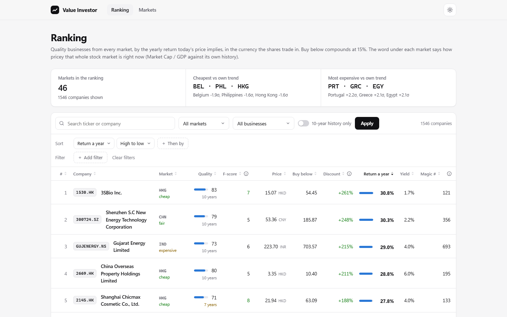
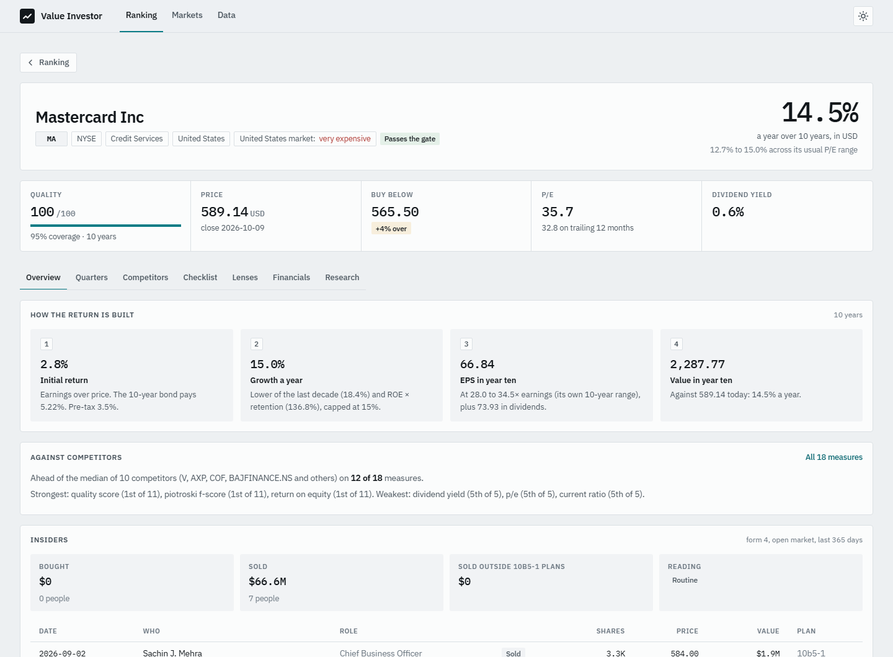
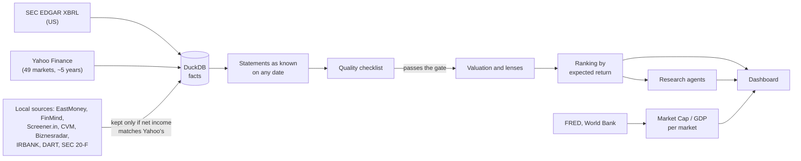
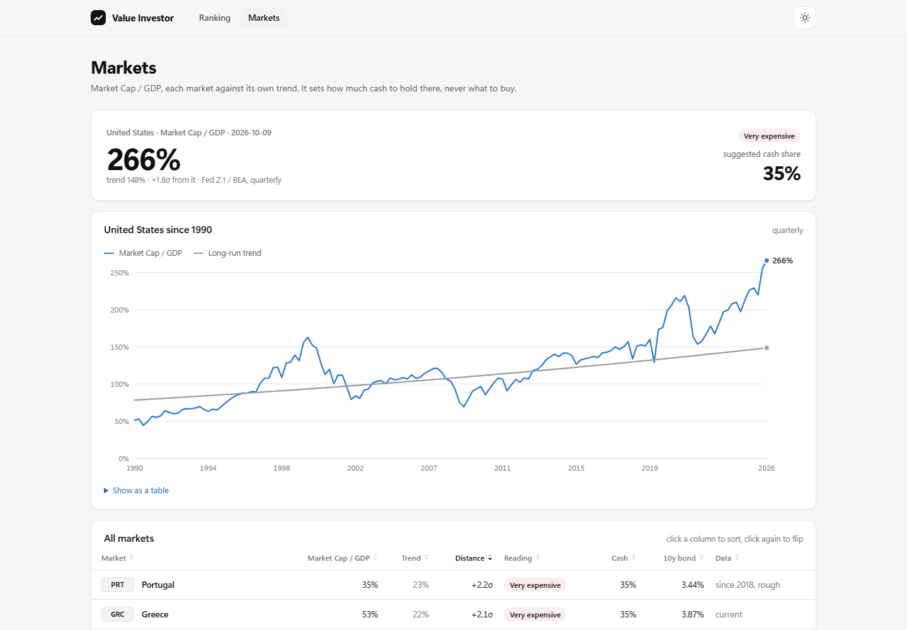

# Value Investor

[](https://github.com/Jkovv/value_investor/actions/workflows/tests.yml)

A screener for the whole world's stock markets that looks for one thing: businesses with a durable
competitive advantage, at a price that still leaves a good return, and above all the ones hardly
anyone is looking at. It reads ten years of financial statements for about 8,000 companies in 47
markets, scores each one against a written checklist, works out what today's price returns over the
next ten years, counts the analysts who follow it, and sends research agents to read up on the ones
that rank highest. Every source it uses is free.



## Why I built it

The value-investing rules I wanted to follow are simple to state and slow to apply: a business
with a lasting advantage shows it as consistency, ten years of steady margins, high returns on
equity without much debt, earnings that keep growing. Checking that by hand means reading a decade
of annual reports per company, and the free screeners only cover a few countries or a few years.
So the goal was a tool that does the reading for every listed company above $1B, in every market
with data, and prices each one in the currency its shares trade in, without paying for data.

The interesting finds are rarely in the S&P 500. A US large cap has thirty analysts pricing it; a
well-run builder in Warsaw or a chemicals maker in Taipei may have a handful, or none, because the big
research houses don't cover the market. Fewer people setting the price is where reading the
statements carefully still pays, so the screener also counts who is looking and puts the good
companies nobody covers on a page of their own.

The rules are written out in **[knowledge/principles.md](knowledge/principles.md)**.

## What it does

| | |
|---|---|
| Companies | 7,909 in 47 markets, one home listing each |
| Ten years of statements | 4,366 companies, from local free sources in 9 markets plus SEC filings |
| Data stored | 3.5M annual and 2.4M quarterly statement facts, 14.3M daily prices, 19k insider trades |
| Ranked | 1,546 companies pass the quality gate and get priced |
| Off the radar | The ones that pass with three analysts or fewer, and the markets where coverage is thinnest |
| Valuation lenses | Piotroski F-score, Altman Z, Graham number, Lynch PEG, Magic Formula, owner-earnings DCF, dividend discount, Monte Carlo |
| Market level | Market Cap / GDP for 50 countries, each against its own trend |
| Research | Four agents (filings, competitors, demand, web) and a writer that cites its evidence, on a local model; started from its own page, a queue, or a company's header |
| Decision aids | The growth today's price needs for 15% a year against the last decade; the kind of moat the statements point to; a watchlist with a digest of what changed |
| Checked | The ranking against what followed, each June since 2010; the briefs sentence by sentence against their sources |
| Cost | Nothing: SEC EDGAR, Yahoo Finance, regulator open data, FRED, World Bank, a local LLM |

Figures as of October 2026.



## Does it work?

Every company was scored again on 30 June of each year since 2010, with only what was public that
day, and set against what its shares returned next, within its own market (37,255 company-years,
20 markets). Method and caveats: **[09 Does it work?](docs/09-evidence.md)**.

- **The valuation ranks in the right order.** Companies that passed the checklist and whose price
  promised less than nothing returned 7.7% a year over the next three years; those promising over
  20% returned 12.2%. Each step up in the promise was a step up in the result. It promises too
  much, so it reads better as a ranking than as a forecast.
- **The checklist alone barely separates winners from losers** (rank correlation 0.03 to 0.05, not
  significant). It narrows the field; the price decides.
- **The research briefs cite too little.** Nine briefs were graded sentence by sentence by a larger
  model: 22% of their sentences cite a source, and of those 41% are fully supported and 4%
  contradict it, every time with a wrong number. All nine end on "Strong candidate", so read them
  for the sources, not the verdict.


## How it works



## The hard parts

- **Point in time.** The same year shows up in several filings, restated. Every fact keeps the date
  it was filed, so the statements can be rebuilt as they were public on any day.
  [03 Data pipeline](docs/03-data-pipeline.md)
- **Stock splits without a split calendar.** When a later filing restates share counts at a clean
  ratio (4.0, 0.25), that is a split, dated at the filing. Checked on Apple, NVIDIA, Alphabet,
  Walmart, Tesla and Coca-Cola.
- **One company, many listings.** NVIDIA trades in Warsaw, Santander in London. Each company keeps
  one home listing, picked by currency, headquarters and turnover.
- **Ten years without paying for data.** Yahoo stops at four or five years. Each market got its own
  free source, and each source is checked against Yahoo before anything is stored: Biznesradar
  converts euro reporters into zloty, IRBANK's debt figures were off by multiples, Korean banks
  only file XBRL from 2023. Korea's filings come from DART's public website, without an API key.
- **Testing on the past without seeing the future.** Yahoo moves every old price into today's share
  units, while an old filing is in the units of its day: NVIDIA's 2020 P/E came out 40 times off.
  Old prices are put back into the units of their date, and a price that triples in a day is
  treated as a broken split adjustment, not a return. [09 Does it work?](docs/09-evidence.md)
- **Agents on a laptop.** One big agent on an 8B local model skipped steps, so research runs in
  stages: code gathers the evidence, four agents dig, one writer cites numbered sources.
  [07 Research agents](docs/07-research-agents.md)

## Quick start

```bash
python -m venv .venv
.venv\Scripts\activate              # source .venv/bin/activate elsewhere
pip install -r requirements.txt
copy .env.example .env              # then set SEC_USER_AGENT to your name + email
ollama pull qwen3:8b                # for the research agents

python ingest.py --markets USA POL DEU JPN --limit 50   # a quick taste
python main.py screen                                   # score, price the ones that pass, rank
python ingest.py --coverage                             # how many analysts follow each one
uvicorn app:app --port 8001                             # dashboard at http://127.0.0.1:8001
python research.py --top 3                              # research briefs for the top three
```

`.env` needs only `SEC_USER_AGENT`. `GROQ_API_KEY`, `HF_TOKEN` and `TAVILY_API_KEY` are optional
and only matter for the research agents.

## The scripts

| Command | What it does |
|---|---|
| `python ingest.py` | Every market: US companies from EDGAR (annual, quarterly, form 4), every other market from Yahoo Finance (one home listing per company, above a $1B floor), plus FRED, World Bank and benchmark series. Only fetches what can have changed. `--us`, `--world`, `--markets`, `--tickers`, `--min-cap`, `--limit`, `--refresh`, `--insiders`, `--quarters`, `--history`, `--coverage`, `--macro-only`. |
| `python main.py screen` | Scores every ingested company, prices the ones that pass the gate, and ranks them by expected return. |
| `python main.py rank` | Prints the last ranking. `--all` includes companies below the gate. |
| `python main.py show KO` | Checklist, valuation steps and ten years of ratios for one company. |
| `python main.py macro` | US rates, the yield curve, Sahm rule and Market Cap / GDP. |
| `python research.py KO` | Deep research agents: filings, competitors, demand trends and the web, then a sourced brief. Resumes an unfinished run. `--top N` for the top of the ranking. |
| `uvicorn app:app --port 8001` | The dashboard: ranking, off the radar, company pages (quarters, competitors, insiders, checklist, lenses, research and questions), research, watchlist, markets, data. |
| `python -m value_investor.llm` | Checks the model router (local Ollama first, then Groq / Hugging Face if keyed). |
| `pytest` | The test suite (155 tests). |

## Documentation

Read `docs/` in order:

[01 Overview](docs/01-overview.md) ·
[02 Tech stack](docs/02-tech-stack.md) ·
[03 Data pipeline](docs/03-data-pipeline.md) ·
[04 Checklist & valuation](docs/04-checklist-and-valuation.md) ·
[05 Markets](docs/05-market-regime.md) ·
[06 Roadmap](docs/06-roadmap.md) ·
[07 Research agents](docs/07-research-agents.md) ·
[08 Compared with other projects](docs/08-compared.md) ·
[09 Does it work?](docs/09-evidence.md)

Every command, in order: **[commands.md](commands.md)**.



## To do

- [ ] Ten years of history for the markets that still only have Yahoo Finance's four or five:
  - **Europe**: ESEF filings only start in 2021 and Germany and Switzerland aren't in the open
    index, so they add a year or two at most; national registers differ country by country.
  - **Canada, Australia and the rest**: companies with SEC filings are already covered; the rest
    needs a source per market.
- [ ] Find a free source for the markets Yahoo Finance doesn't cover, so their companies can be
      screened too:
  - **Egypt**: 259 listings, but no market caps, so the size floor drops them all.
  - **Philippines, Vietnam**: the screener returns nothing (their Market Cap / GDP still shows).
  - **UAE, Colombia, Peru, Pakistan, Sri Lanka**: no listings at all.
  - **Russia**: dropped by Yahoo after the 2022 sanctions.
  - **Latvia, Venezuela, Suriname**: nothing above the $1B floor (Venezuela's market caps read as
    zero), so these only matter if the floor comes down.
- [ ] A fuller test of the ranking: the whole US market, and delisted companies if a free source
      turns up ([06 Roadmap](docs/06-roadmap.md)).
- [ ] Briefs: check every figure against its source in code before a sentence is kept, and mark the
      judge's sample by hand ([09 Does it work?](docs/09-evidence.md)).
- [ ] Move the research agents to AWS, or at least experiment with it: Amazon Bedrock as one more
      backend in the model router, a larger writer than the local 8B model, keys only in `.env`.
      `python main.py evals` then shows whether the briefs cite more and get less wrong.
- [ ] Off the radar, further down: lower the $1B floor in the least-covered markets, since the
      companies nobody follows are mostly smaller.
- [ ] Keep every month's analyst counts instead of only the latest, so that in a year or two it can
      be tested whether the good companies nobody covered did better. No free source keeps past counts.
