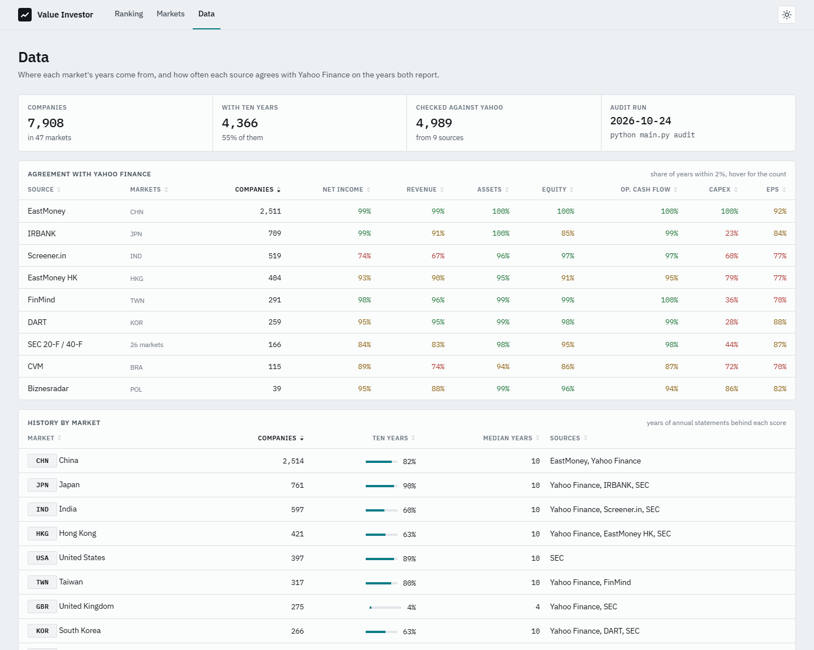
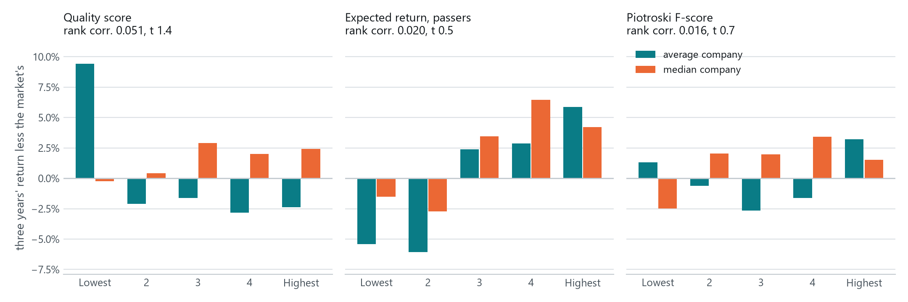
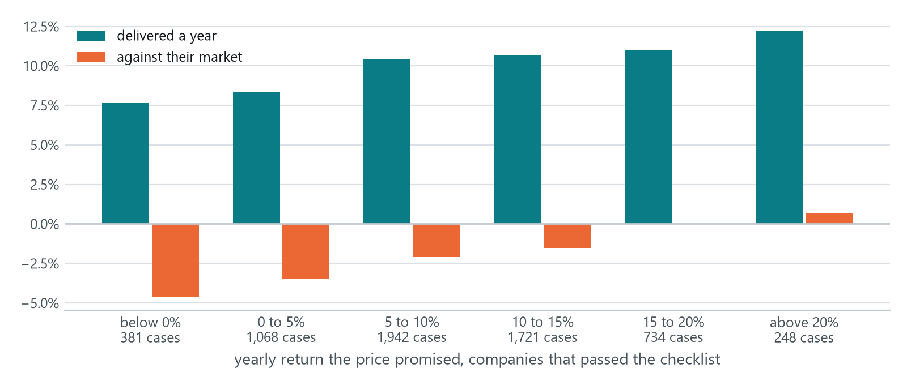
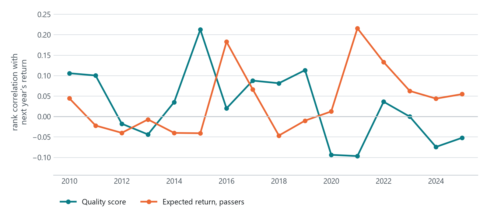

# 09. Does it work?

Three questions, each answered with the project's own data:

1. Can the free sources be trusted? Each one is checked against a second source, line by line.
2. Would the ranking have picked the better companies? Every company is scored again each June
   since 2010 with only what was known that day, and set against what its shares did next.
3. Do the research briefs say what their sources say? Every cited sentence is checked against the
   source it cites.

The short answers: the sources mostly agree, with known exceptions that were taken out; the
valuation ranks companies in the right order but promises more than it delivers; the quality
checklist on its own barely separates winners from losers; and the local model ties under a
quarter of what it writes to a source, and calls every company a strong candidate.

## 1. The data

`python main.py audit` compares every source that adds history outside the US with Yahoo
Finance, on the years both report. A line counts as agreeing when the two figures are within 2%.

| Source | Market | Companies | Net income | Revenue | Assets | Equity | Op. cash flow | Capex | Years compared |
|---|---|---|---|---|---|---|---|---|---|
| EastMoney | China | 2,511 | 99% | 99% | 100% | 100% | 100% | 100% | 10,018 |
| IRBANK | Japan | 709 | 99% | 91% | 100% | 85% | 99% | 23% | 2,824 |
| Screener.in | India | 519 | 74% | 67% | 96% | 97% | 97% | 60% | 1,992 |
| EastMoney HK | Hong Kong | 404 | 93% | 90% | 95% | 91% | 95% | 79% | 1,578 |
| FinMind | Taiwan | 291 | 98% | 96% | 99% | 99% | 100% | 36% | 1,127 |
| DART | South Korea | 259 | 95% | 95% | 99% | 98% | 99% | 28% | 990 |
| SEC 20-F / 40-F | 26 markets | 166 | 84% | 83% | 98% | 95% | 98% | 44% | 605 |
| CVM | Brazil | 115 | 89% | 74% | 94% | 86% | 87% | 72% | 459 |
| Biznesradar | Poland | 39 | 95% | 88% | 99% | 96% | 94% | 86% | 156 |

What the disagreements turned out to be:

- **Capex** disagrees almost everywhere. Yahoo reports cash spent on property and equipment; most
  local sources report capital investment as the company states it, which includes intangibles
  and spending not yet paid. The median gap in Japan is 1%, so it's noise, not a bias.
- **Screener.in's net income** agrees in only 74% of years, against Yahoo's figure for the owners
  of the company and its total alike. The cause isn't pinned down yet.
- **Lines that were dropped** because they didn't hold up: IRBANK's debt (off by up to 500 times,
  and the same figure for eight years for Toyota) and SG&A, DART's SG&A (it includes R&D).
- **Whole sources that were refused**: Biznesradar converts euro and dollar reporters into zloty,
  so those five companies stay on Yahoo.
- **Equity in Japan** (85%): IRBANK's equity leaves out unrealised gains; it's rebuilt from book
  value per share instead.

A source is stored for a company only when its net income agrees with Yahoo's in at least half the
years both have. The same table is on the dashboard's **Data** page.



## 2. The ranking, tested on the past

`python main.py study` scores every company again on 30 June of each year from 2010, using only
what was public that day:

- statements filed by then (real filing dates where the source has them, otherwise an estimate:
  three months after the year end in Japan, the legal deadline there, and four for Yahoo);
- prices up to that day, in that day's share units (later splits taken back out);
- that month's 10-year government bond yield.

The score is set against what the shares returned over the next one and three years, dividends
reinvested, in the currency they trade in. Companies are only compared with others in the same
market and year, so how a whole market did drops out.

**Sample.** 37,255 company-years, 4,859 companies in 20 markets, June 2010 to June 2025. The bulk is
China (12,521, from 2020), Japan (9,781), the US (4,053), Hong Kong (3,589), India (2,918), Taiwan
(1,834) and Korea (1,166). Only companies with more history than Yahoo's four years can be scored
back then.

**Statistics.** For each market and year with at least 20 companies: the rank correlation between
the signal and the return that followed, and the average and median return of each fifth against
the market's. Markets are averaged within each year, then years are averaged. t-statistics use
Newey-West errors for the overlapping three-year windows. Averages leave out the top and bottom 1%
of each market's year; a price that triples or thirds in one day is treated as a broken split
adjustment, not a return.

| Signal | Horizon | Years | Rank corr. | t | Top fifth less bottom, average | t | Median | t |
|---|---|---|---|---|---|---|---|---|
| Quality score | 1 year | 16 | 0.026 | 1.2 | -6.0% | -2.0 | +1.8% | 0.6 |
| Quality score | 3 years | 14 | 0.051 | 1.4 | -11.8% | -1.1 | +2.7% | 0.4 |
| Expected return, among passers | 1 year | 16 | 0.038 | 2.0 | +0.4% | 0.2 | +1.5% | 0.7 |
| Expected return, among passers | 3 years | 14 | 0.020 | 0.5 | +11.3% | 1.0 | +5.7% | 0.8 |
| Piotroski F-score | 1 year | 16 | 0.000 | 0.0 | +1.4% | 0.5 | +0.9% | 0.6 |
| Piotroski F-score | 3 years | 14 | 0.016 | 0.7 | +1.9% | 0.3 | +4.0% | 0.8 |



**The valuation ranks in the right order, and promises too much.** Among companies that passed
the checklist, those whose price promised less than nothing went on to return 7.7% a year; those
promising over 20% returned 12.2%. Every step up in the promise was a step up in the result, and
against their own market the gap runs from -4.6% to +0.6% a year. But a company promising 20% a
year delivered 12%: the figure is better read as a ranking than as a forecast.



| Promised a year | Cases | Delivered a year (median) | Against their market |
|---|---|---|---|
| below 0% | 381 | 7.7% | -4.6% |
| 0 to 5% | 1,068 | 8.4% | -3.5% |
| 5 to 10% | 1,942 | 10.4% | -2.1% |
| 10 to 15% | 1,721 | 10.7% | -1.5% |
| 15 to 20% | 734 | 11.0% | 0.0% |
| above 20% | 248 | 12.2% | +0.6% |

**The expected return holds across markets.** Its one-year rank correlation is positive in Japan
(t 2.2), Korea (3.6), India (1.7), China and Hong Kong, negative only in Taiwan and in Brazil's one
usable year.

**The quality score on its own is weak.** The median company in the top fifth beat the median in
the bottom fifth by 1.8% over a year and 2.7% over three, but not reliably, and the averages point
the other way: the lowest fifth holds a few companies whose shares multiplied. Fifths two to five
do line up in order. The score worked in Poland (three-year rank correlation 0.136, t 3.5) and the
US (0.066, t 1.5), and failed in China, India and Korea. It held up through the 2010s and turned
negative in 2020 and 2021, when the weakest businesses rallied hardest.



**Passing the checklist alone wasn't worth anything**: passers returned 1.9% a year less than the
rest of their market (t -1.2). What it buys is a smaller field in which the price then decides.

**Piotroski's F-score**, run through the same machinery as a benchmark, shows nothing either way.

### What can bend these numbers

- **Only today's companies.** Free price data has no delisted shares, and outside the US only
  companies above $1B today are stored. A weak business from 2015 is in the sample only if it grew
  large since, which flatters the weakest fifth most. That works against the quality score, so its
  real effect is likely somewhat better than measured, but there is no way to show it with free data.
- **Some filing dates are estimated** (IRBANK, Screener.in, FinMind, EastMoney HK, Yahoo), and some sources give
  restated figures rather than the ones first filed. Both let a little of the future in.
- **The US sample is 397 large NYSE and Nasdaq companies**, not the whole market. `python ingest.py
  --us` loads all of it; the study then runs again unchanged.
- **China only counts from 2020**: its statements start in 2016, and four years are needed.
- **Six tests** (three signals, two horizons): a t-statistic of 2 on one of them is weak evidence.
- **Briefs and agents aren't in it.** The model has read about what happened after 2010, so they
  can't be tested on the past honestly.

## 3. The research briefs

`python main.py evals` takes every brief saved with its evidence and checks each sentence that
cites a source against the excerpt of that source the writer was given. The judge is a larger
model than the writer (gpt-oss-120b on Groq's free tier, against qwen3:8b running locally), with
four verdicts: supported, partly, not in the source, contradicted. Sentences that cite nothing are
checked for names that appear nowhere in what the writer was given, the way small models fill gaps.
A sample can be written out for marking by hand (`--sample 60`) to measure how far the judge
itself agrees with a person.

**Sample.** Nine briefs, one company per market, each passing the checklist. Each took the local
model between one and three hours and drew on 21 to 38 sources.

| Brief | Market | Sentences citing a source | Supported | Partly | Not in the source | Contradicted |
|---|---|---|---|---|---|---|
| Mastercard | US | 7 of 41 | 57% | 43% | 0% | 0% |
| Keyence | Japan | 14 of 36 | 29% | 7% | 50% | 14% |
| Kweichow Moutai | China | 4 of 41 | 0% | 25% | 75% | 0% |
| Tencent | Hong Kong | 0 of 41 | | | | |
| TCS | India | 10 of 34 | 40% | 30% | 30% | 0% |
| Dom Development | Poland | 12 of 37 | 42% | 42% | 17% | 0% |
| Ambev | Brazil | 11 of 42 | 45% | 36% | 18% | 0% |
| RELX | UK | 0 of 40 | | | | |
| Hugel | Korea | 18 of 34 | 50% | 39% | 6% | 6% |
| All nine | | 76 of 346 | 41% | 32% | 24% | 4% |

**They cite too little.** The writer is told to cite every claim; at best half its sentences do,
and the Tencent and RELX briefs cite nothing at all. Over three quarters of what the briefs say
can only be checked against the reader's own knowledge.

**What is cited mostly holds.** Of the cited sentences, 41% say what the source says and 32% go
further than it. A typical "partly" joins a figure that is in the source to a claim that isn't:
the 77% gross margin is there, the strong brand recognition isn't. A quarter aren't in the cited
source at all.

**The writer had nothing to cite its own numbers by.** Sentences citing the project's computed
figures (peers, quarters, insiders) were supported more often than those citing web pages (47%
against 31%), but 32% of them weren't in the cited source. Most of those are true: the figure is
in the block of computed numbers the writer is given first, which had no number of its own, so the
writer put it on the nearest source. Moutai's 92% gross margin is cited to its quarterly results;
the Hugel brief invented a "[computed numbers]" label. The block is now source [0]. It is also
where the weakest section, *Competitive advantage* (2 of 10 cited sentences supported, 5 not in
the source), takes its margins from.

**Every contradiction is a slip with a number.** Keyence's revenue growth given as 12.1% where the
source shows about 5%; its 14% return on equity called "below" a peer median of 12%; Hugel's P/E
given as 14.3 against 12.7 in the source. Code can catch these by comparing the figures in a
sentence with those in its source, which a model of this size can't be relied on to do.

**Every brief ends on "Strong candidate"**, including Keyence, RELX and Ambev, whose price promises
9% a year or less against the 15% the valuation asks for. A verdict that never changes adds
nothing to the checklist the nine had already passed.

**Names from nowhere are rare**: four sentences in nine briefs name something no source the writer
had mentions. One is real but unsourced (WeChat's Mini Programs); the rest can't be confirmed from
the sources (a Keyence Foundation among the shareholders, a "Moutai Organic" product line, and a
Moutai chairman, vice chairman and director). The check shows what a reader can't verify, not
what is wrong.

**Faithful to a source isn't the same as right.** The Mastercard brief names a chief executive
who stepped down at the start of 2021, copied faithfully from an outdated page among its sources.
A check against sources can't catch that.

**The judge itself hasn't been checked against a person yet.** `--sample 40` writes 40 sentences
to `data/evals/labels.csv` to mark by hand; the next run reports how often the judge agrees, and
Cohen's kappa.

Read a brief, then, as a reading list with commentary: the sources are real and listed, but under
a quarter of what it says is tied to one, and its verdict carries no information. What would
change that: figures checked in code before a sentence is kept, a larger writer model, and a
verdict that has to square with the price.

## Reproduce

```bash
python main.py audit                  # section 1, a few minutes
python main.py study                  # section 2, an hour or two on a laptop
python main.py study --reuse          # the statistics again on the last scored panel
python research.py MA 6861.T 0700.HK   # briefs to grade
python main.py evals                  # section 3, needs GROQ_API_KEY for the judge
```

Next: back to **[01 Overview](01-overview.md)**.
